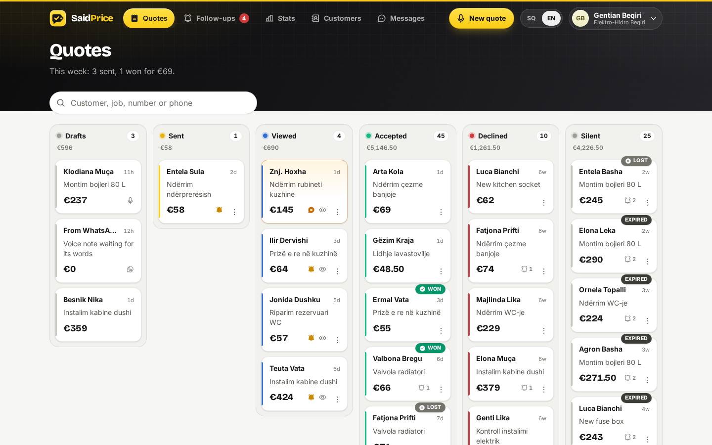
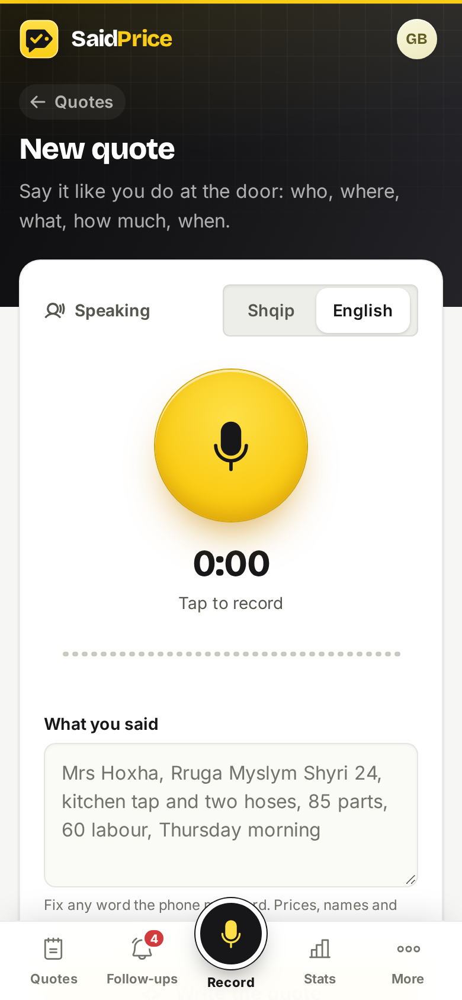
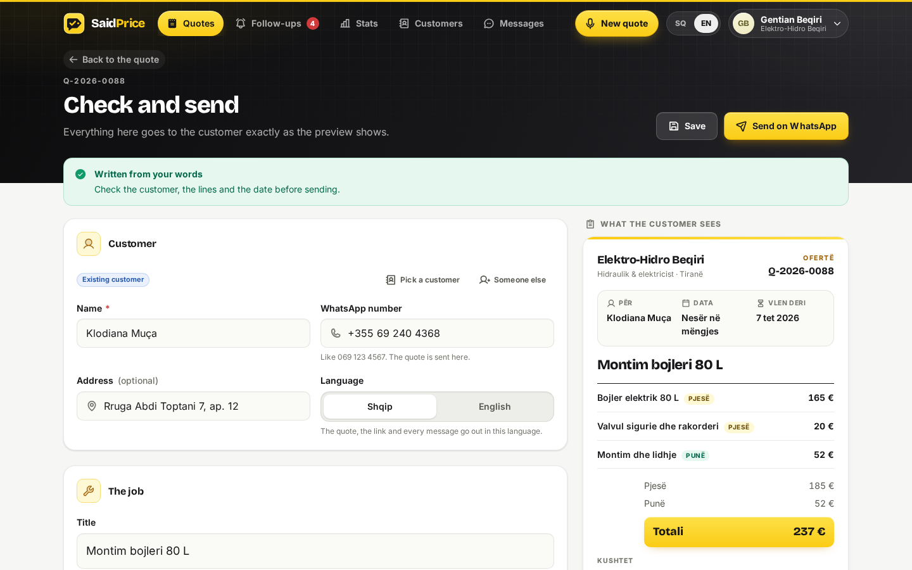
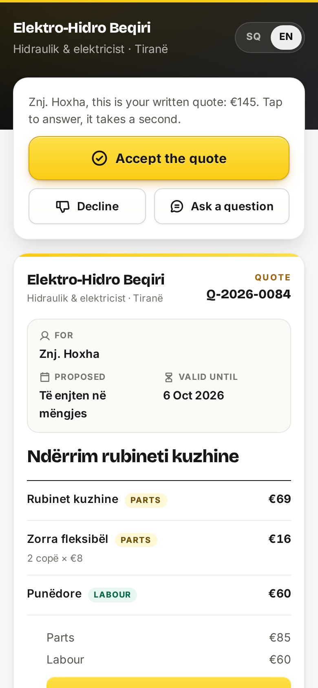
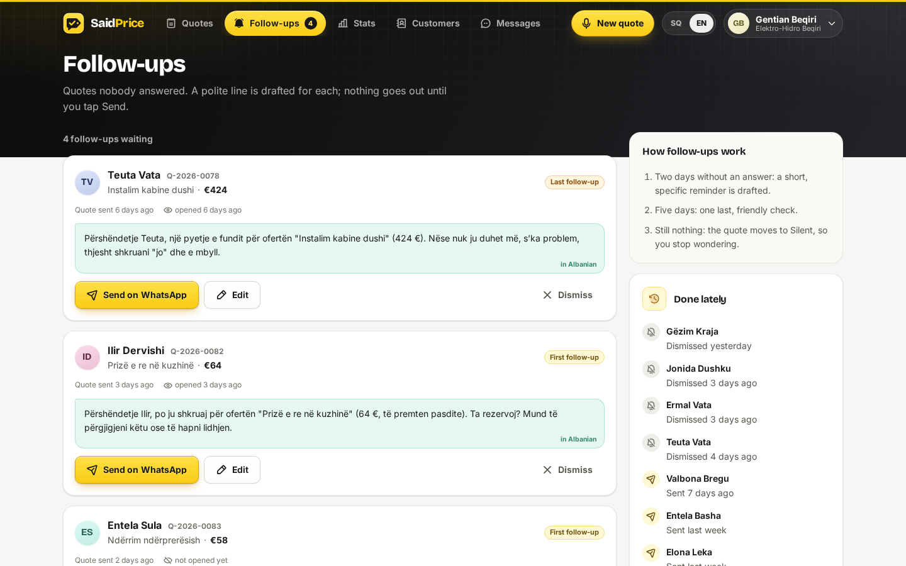
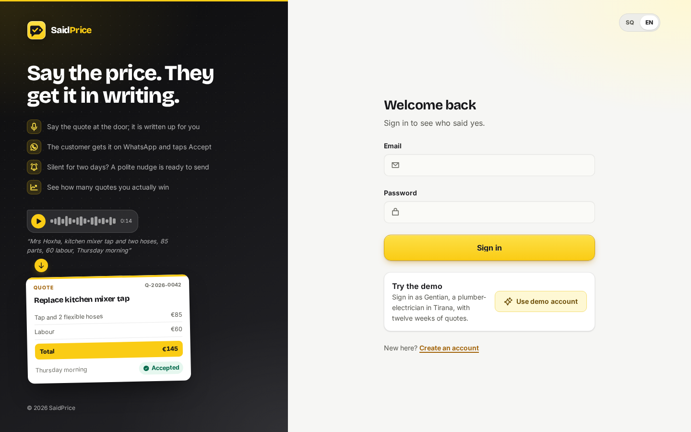
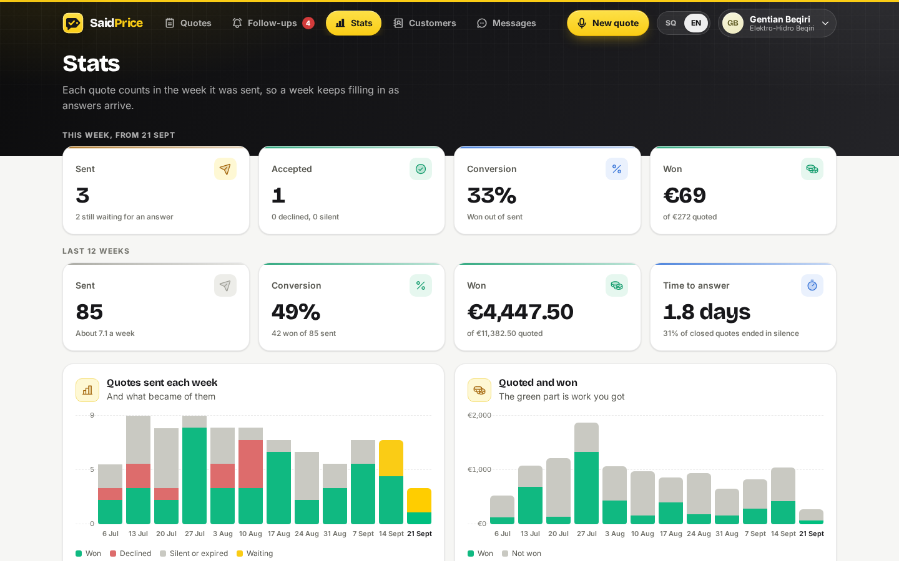
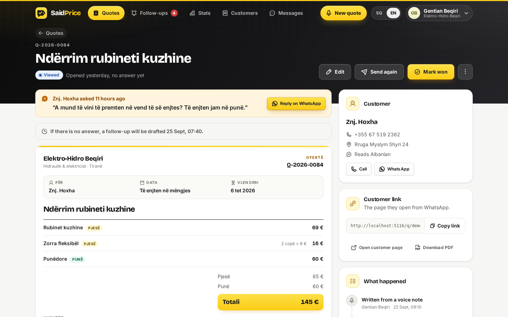

# SaidPrice

Say the quote out loud at the door; the customer has it in writing on WhatsApp within a minute, and you find out whether they ever said yes.

<table>
  <tr>
    <td width="72%"></td>
    <td width="28%"></td>
  </tr>
</table>

## Why

A plumber or electrician gives five to fifteen quotes a week, and almost all of them are spoken: "about 350, I can do Thursday". None are written down, so at payment time there are disputes ("you said 300"), and he never learns which quotes he won. Following up feels like begging, so he doesn't. Field-service apps expect line items typed in a hallway, which nobody does. SaidPrice keeps the habit he already has, talking, and turns it into a written quote, a polite follow-up and, for the first time, a conversion rate.

## What it does

- **Quote by voice.** A big record button records the voice note (MediaRecorder) while the browser writes a live transcript (Web Speech API, `sq-AL` or `en-GB`). The transcript stays editable, and "Type instead" is always there.
- **Read into a quote.** "Znj. Hoxha, Rruga Myslym Shyri 24, ndërrim rubineti kuzhine dhe dy zorra, 85 pjesë, 60 punë, të enjten në mëngjes" becomes a customer, an address, priced lines for parts and labour, and a proposed date. Claude reads it when `ANTHROPIC_API_KEY` is set; otherwise a rule-based parser does (see How it works).
- **Editor with a live preview.** Lines with quantity, unit, price and kind (parts, labour, other), totals as you type, proposed date with quick picks, validity, notes and terms, next to the quote exactly as the customer will see it, in the customer's language.
- **Send on WhatsApp.** Through the WhatsApp Cloud API when configured; otherwise the message waits in the outbox with a one-tap "Open in WhatsApp" link that sends it from the tradesperson's own phone.
- **The customer's page** (`/q/:token`, no login): business, lines, total, proposed date, valid until, terms, a PDF, and **Accept**, **Decline** (with an optional reason) and **Ask a question**. The first open marks the quote *viewed*; every answer lands on the timeline and is forwarded to the business phone.
- **Replies on WhatsApp.** "po", "yes" or "1" accepts the customer's latest open quote, "jo", "no" or "2" declines it, anything else becomes a question on their latest quote. A voice note (or a typed quote) sent to the platform number from the business phone becomes a draft.
- **Follow-ups that are drafted, never sent on their own.** Two days without an answer, a short, specific line is drafted ("…the quote "Ndërrim rubineti kuzhine" (145 €, të enjten në mëngjes). Ta rezervoj?"); five days after sending, one last check; still nothing, the quote goes *silent*. The Follow-ups inbox has Send, Edit and Dismiss for each.
- **Pipeline** of drafts, sent, viewed, accepted, declined and silent quotes (columns on desktop, tabs on phones), with search, counts, the value of each column, and signals for questions, pending follow-ups and voice notes.
- **Quote detail**: lines, customer with call and WhatsApp buttons, the whole timeline (created, sent, opened, follow-ups, answers, outcome), resend, duplicate, PDF, mark won or lost with a reason.
- **Stats**: this week and the last 12 weeks: sent, accepted, declined, silent, value quoted against value won, conversion, median time to answer, and charts by week.
- **Customers** with their history and totals, **Settings** for trade, validity, follow-up timing, standard terms and the business phone, and a **team** with an assistant role that can draft and send quotes.
- Everything in **Albanian and English**, including the WhatsApp messages and the PDF, which go out in the customer's language.

<table>
  <tr>
    <td width="65%"></td>
    <td width="35%"></td>
  </tr>
  <tr>
    <td></td>
    <td></td>
  </tr>
  <tr>
    <td></td>
    <td></td>
  </tr>
</table>

## How it works

**From voice to lines.** The recording is kept with the quote; the transcript is what gets read. Without an API key, `QuoteParser` (`backend/app/Quotes/Parsing`) handles the way quotes are actually said, in both languages and with or without the punctuation speech recognition leaves out. It first claims the phone number, the name after a title ("Znj.", "Mrs", "për Zotin …"), the address after a street word ("Rruga e Kavajës 12, ap. 4") and the date phrase ("të enjten në mëngjes", "Monday at 10"). What remains is cut into priced pieces around the amounts: "85 pjesë", "labour 70", "two hoses at 8 each", "2 orë punë nga 25", "120 euro all in", "3.500 lekë". A kind word can come before or after its amount ("85 parts 60 labour" and "heater 180 labour 70" mean different things), so both readings are tried and the one that leaves no stray kind words wins. Sizes like "80 L" stay in the description, counts become quantities, and a description said on its own names the first price after it. It does not need to be perfect: the editor comes next. With `ANTHROPIC_API_KEY` set, Claude returns the same structure through a JSON schema, and the parser is the fallback.

**Status machine.** `QuoteStatus` holds the transition table: draft → sent → viewed → accepted or declined; sent or viewed → silent; sent, viewed or silent → expired; resending renews silent and expired quotes. An accepted quote is final: that is the written agreement. The outcome (won or lost) is separate from the status: "won" on an open quote means the customer said yes by phone, "lost" closes it so nobody chases it.

**Follow-ups.** `FollowUpSchedule` is a pure function of times: the first follow-up falls due `first_nudge_hours` (48) after sending; the second `second_nudge_days` (5) after sending, but never sooner than 48 hours after the first was acted on; 48 hours after the second, the quote goes silent. Nothing is drafted while a draft waits, and a customer question restarts the quiet period, because then it is the tradesperson's turn. Past the last valid day (in the business's time zone) the quote expires instead. The hourly `quotes:follow-up` command applies the schedule and only ever drafts.

**Stats.** Each quote counts in the week it was sent (Monday to Sunday, Tirana time), so last week's numbers keep filling in as answers arrive. Won means marked won, or accepted and not marked lost. Conversion is won out of sent; the median time to answer uses quotes the customer accepted or declined.

**Albanian formatting.** Chrome and Android ship without Albanian locale data, so `Intl` quietly formats Albanian as English there. Dates, money and relative times in Albanian are therefore written out by hand (`frontend/src/lib/albanian.ts`): "7 tet 2026", "1250,50 €", "para 3 ditësh".

## Stack

- **Backend:** Laravel 12 (PHP 8.2), PostgreSQL, Sanctum SPA session cookies, `barryvdh/laravel-dompdf` for the PDF, the Anthropic PHP SDK for optional extraction.
- **Frontend:** Vue 3.5, Vite, TypeScript, Pinia, vue-i18n, Phosphor icons, Bricolage Grotesque and Inter. MediaRecorder and the Web Speech API in the browser; no speech service on the server.
- **Messaging:** WhatsApp Cloud API with an outbox that always keeps a copy, and a `wa.me` fallback.

## Run it locally

Prerequisites: PHP 8.2 with `pdo_pgsql`, `intl`, `mbstring`, `gd` and Composer; Node 22; PostgreSQL 14+.

```bash
# database
createuser -P saidprice          # password: saidprice
createdb -O saidprice saidprice
createdb -O saidprice saidprice_test

# backend (http://localhost:8116)
cd backend
composer install
cp .env.example .env
php artisan key:generate
php artisan migrate --seed       # twelve weeks of demo data
php artisan serve --port=8116
php artisan schedule:work        # in another terminal: drafts follow-ups every hour

# frontend (http://localhost:5116)
cd frontend
npm install
PORT=5116 BACKEND_URL=http://127.0.0.1:8116 npm run dev
```

Sign in with **demo@saidprice.test / demo1234** (Gentian Beqiri, owner of Elektro-Hidro Beqiri in Tirana) or **assistant@saidprice.test / demo1234** (Elira, assistant). In demo mode, Messages has a WhatsApp simulator: answer a quote as a customer ("po", "jo", a question) or send a voice note from the business phone and watch a draft appear.

For production, `npm run build` in `frontend/` and copy `dist/` into `backend/public/`; Laravel serves the app and the API from one origin. Run `php artisan schedule:run` every minute from cron.

## Configuration

All product settings are read in `backend/config/product.php`.

| Variable | What it does | Without it |
| --- | --- | --- |
| `APP_PUBLIC_URL` | Base URL of the web app, used in the links sent to customers | Links point to `http://localhost:5173` |
| `APP_DEMO` | Seeds the demo business and enables the WhatsApp simulator | `true` by default; set `false` in production |
| `MESSAGING_DRIVER` | `log` keeps messages in the outbox, `whatsapp` sends them | Outbox with "Open in WhatsApp" links |
| `WHATSAPP_TOKEN`, `WHATSAPP_PHONE_NUMBER_ID` | WhatsApp Cloud API credentials | Nothing is sent by the API |
| `WHATSAPP_APP_SECRET`, `WHATSAPP_VERIFY_TOKEN` | Webhook signature check and verification (`/api/webhooks/whatsapp`) | Webhook accepted only in demo mode |
| `ANTHROPIC_API_KEY`, `ANTHROPIC_MODEL` | Claude reads transcripts into quotes | The rule-based `QuoteParser` reads them |

WhatsApp only delivers business-initiated messages from approved templates. Create templates for `quote_sent`, `quote_nudge`, `quote_thanks` and the three business notices in both languages, then map them in `config/product.php` under `messaging.whatsapp.templates`, for example `'quote_sent' => 'saidprice_quote|name,business,number,title,total,when,valid_until,link'`. Unmapped messages go out as plain text, which WhatsApp accepts only within 24 hours of the customer's last message. The texts themselves live in `backend/lang/{sq,en}/msg.php` and `nudge.php`.

Voice notes forwarded from the business phone need the WhatsApp media API, so they arrive with their audio only when WhatsApp is configured; in demo mode the draft is created without it.

Live transcripts work in Chrome, Edge and Safari (desktop and mobile). Firefox records the voice note but has no speech recognition, so the transcript is typed.

## Tests

```bash
cd backend && php artisan test      # 132 tests: parser, totals, status machine, follow-up schedule and job,
                                     # capture, editor, sending, public page, WhatsApp replies, stats,
                                     # customers, settings, tenant isolation
cd frontend && npm run type-check && npm test && npm run build-only
                                     # 37 tests: line totals, Albanian formatting, recorder level meter,
                                     # transcript joining, stats helpers
```

Backend tests run against the PostgreSQL database `saidprice_test`.

## Project structure

```
backend/
  app/Quotes/               status machine, workflow, capture, editor, totals, stats, PDF, messages
  app/Quotes/Parsing/       QuoteParser, its vocabulary, ParsedQuote
  app/Quotes/FollowUps/     schedule (pure), hourly runner, drafter, inbox actions
  app/Messaging/Handlers/   WhatsApp: customer replies, business voice notes
  app/Http/Controllers/     quotes, public quote page, customers, follow-ups, stats, settings
  database/seeders/         twelve weeks of demo quotes played through the real workflow
  lang/{sq,en}/             WhatsApp texts, follow-up drafts, PDF labels, errors
  resources/views/pdf/      the quote PDF
  tests/                    Unit (parser, status, totals, schedule) and Feature tests
frontend/src/
  views/                    pipeline, new quote, editor, detail, follow-ups, stats, customers, public quote
  components/quote/         quote card, document, timeline, line editor, dialogs, follow-up card
  lib/                      quote rules, recorder, speech, Albanian formatting
  i18n/                     sq.ts and en.ts
```

## License

MIT, see [LICENSE](LICENSE).
